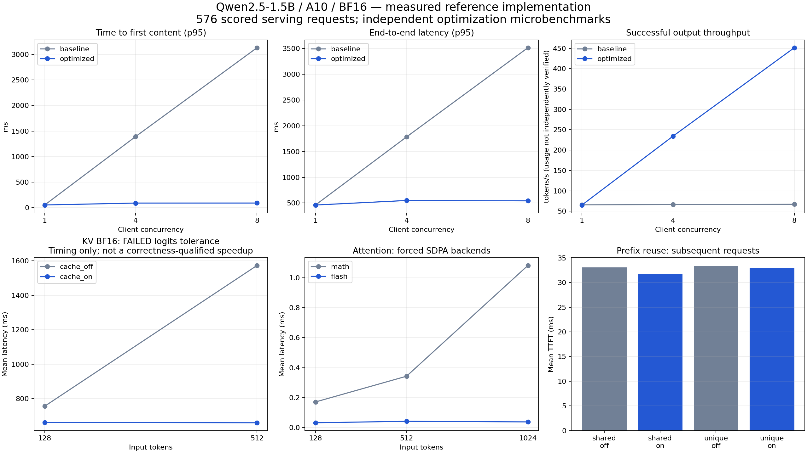
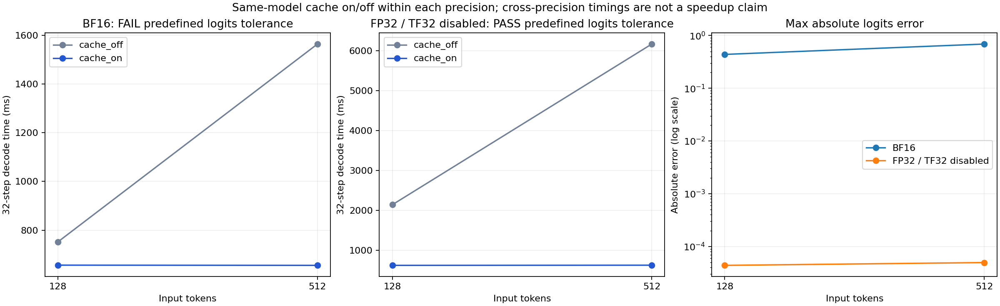

# A10 实测与项目验收证据

当前服务候选已切换为 Qwen2.5-7B-Instruct BF16（revision `a09a35458c702b33eeacc393d103063234e8bc28`），KV 原理实验仍为独立 1.5B FP32。尚无本候选通过完整 GPU 验收的结论；下文及 results 中已有测量保留原模型、提交与环境身份。

2026-10-17，在独占 Lambda NVIDIA A10 上，从没有项目依赖和模型缓存的新 VM 开始，由平台可信控制器 clone 指定 Git commit，执行 `setup.sh`、正式评分和优化实验，再销毁 VM。自动分 **50/50**，576/576 个正式请求成功且答案正确，10/10 个 Agent 任务通过。上述为历史 llm-lab/2.0 的 50 分自动结果，其 50 分人工配置已被修正。当前 llm-lab/4.0 为自动 95 分、人工仅 5 分，新增 Daytona 固定负载数字门槛与最终部署配置联动；本页仅保留历史 A10 数据，不改写、不按比例换算，也不作为 Daytona 已通过的证据。

评分器使用 `extraction-typed/1` 工作负载，控制器修正版本为 `5ade1aa1fdccc7dc9deb7247a60b9f0319088fb9`。

正式结果对应 commit `72dae3fd2f0d8146b9f41fb62dd55c2402cc92d7`，运行编号 `a26db4f7-56c8-4b1a-a8d7-985bc45e7a06`。发布结果/图表的后续 commit 不代表重新运行 GPU。第三轮正式复测及 FP32 对照对应 commit `01340d52c5f2b72f0502af6ca3906261d846c10e`，运行编号 `0c135590-8f0e-4148-bf3c-793ff3458347`；正式复测再次 50/50，576/576 正确、Agent 10/10，冷启动 193.57 秒，完整评分 457.67 秒。完整数据在 `results/confirmation/`。



## 干净重建与接口

首次 clone、镜像/依赖安装、模型下载与健康就绪共 **197.19 秒**；完整正式评分 **466.33 秒**，不含 VM 开机等待与后续优化实验。同配置重跑幂等，切换 optimized 后重新就绪。固定 Qwen2.5-1.5B-Instruct revision、SGLang 0.5.2、BF16 和镜像 digest，详见 Dockerfile、各实验 manifest 及 `results/formal/declared-info.json`。

自动分组成：重建 10/10，接口 10/10，质量 10/10，性能 15/15，Agent 5/5。健康检查、鉴权、模型信息、普通响应和 SSE 均经过真实 GPU 调用。Agent 执行模型规划→白名单 lookup_order→模型回答，源码见 `agent/agent.py`；正式行为测试 10 个随机订单，实测网关另记录 20 次模型调用。

20 次真实流式连接取消均归还执行槽位，最终网关 active=0、queued=0、cancelled=20，abort acknowledged 增加 20。引擎 running requests、queue requests 和 token usage 均归零；这说明活动请求已释放，不要求 CUDA 预分配池归零。证据见 `results/cancellation/`。

## 连续批处理与服务性能

固定模型/revision、BF16、4096 上下文、Triton attention、prefix off、CUDA Graph off、相同输入和输出上限。baseline engine running-request=1/token-budget=8192，optimized=8/16384；网关两组均为 8 slots/16 queue。因此这是两项调度参数组成的 profile 对照，不能单独归因于其中一个参数。

外部闭环并发 1/4/8，每档 3×32 请求；各轮代表性预热单独记录。SLO：TTFT≤200 ms 且 E2E≤1500 ms。每行 96/96 请求成功且答案正确。

| Profile | 并发 | TTFT p95 ms | E2E p95 ms | 输出 tokens/s | Quality goodput req/s |
|---|---:|---:|---:|---:|---:|
| baseline | 1 | 52.18 | 463.14 | 65.53 | 2.25 |
| baseline | 4 | 1393.22 | 1783.44 | 66.22 | 0.071 |
| baseline | 8 | 3131.31 | 3513.63 | 66.88 | 0.072 |
| optimized | 1 | 53.26 | 462.01 | 65.06 | 2.23 |
| optimized | 4 | 90.35 | 550.13 | 234.17 | 8.04 |
| optimized | 8 | 90.90 | 542.89 | 451.57 | 15.50 |

并发 8 时吞吐约 **6.75×**，TTFT p95 从 3.13 s 降到 90.90 ms。并发 1 几乎不变，符合增加调度并发主要改善多请求排队的解释。收益有资源代价：更多活跃请求和更大的 token budget；不能无限提高并发，仍需受显存与 SLO 限制。

## KV Cache：保留失败的数值检查

固定 128/512-token 输入，先生成固定 32-token continuation；两分支回放同一 token 序列，比较每个位置的全词表 logits。cache on 先 prefill，逐 token 计算；cache off 每步重算完整历史。decode 计时不含 tokenize/加载/prefill。预热后 on/off 交替三次。

| 输入长度 | 重算历史均值 ms | KV 均值 ms | 全词表最大绝对误差 | 预设数值检查 |
|---|---:|---:|---:|---|
| 128 | 755.69 | 661.75 | 0.4375 | 失败 |
| 512 | 1573.33 | 659.64 | 0.6875 | 失败 |

BF16 两组均使用 eager attention，预设 atol=0.15/rtol=0.02。虽然计时差异可见，但两组未通过这个数值门槛，**不能把计时比宣布为正确性已验证的优化收益**。所有 12 条记录、失败状态和非零退出保存在 `results/kv/rehearsal/`；不修改容差，也不删除失败。

从数学上看，因果模型的第 ℓ 层旧位置隐藏状态 `hℓ(t)` 只依赖 token 1…t。追加 t+1 后，旧位置不读取未来 token，因此 `Kℓ(t)=hℓ(t)Wkℓ`、`Vℓ(t)=hℓ(t)Wvℓ` 可保留；新位置计算 `Qℓ(t+1)` 并读取 `Kℓ(1:t+1), Vℓ(1:t+1)`。这解释了缓存语义，不保证两种浮点执行路径逐位相同。

Cache 计算改变了矩阵运算形状，低精度结果可能不同；这是一种待对照检验的解释，而不是“缓存天然准确”的证明。[PyTorch 2.8 数值说明](https://docs.pytorch.org/docs/2.8/notes/numerical_accuracy.html) 也指出，相同数学运算的批量与切片计算不保证逐位一致。独立 FP32/禁 TF32 实验使用更严格的预设 atol=0.001/rtol=0.0001，结果单独记录，不替代 BF16 验收。

### FP32 控制：数值检查通过

第三轮在同一 A10 上重新跑 BF16，并运行 FP32/TF32 disabled 对照。两种精度使用同一模型 revision；两档输入的 prompt hash 和固定 continuation hash 均相同。每种精度内部仍只改变 cache on/off；不存在把 BF16 与 FP32 的耗时相除当成缓存收益。

| 精度 | 输入长度 | 无缓存均值 ms | 有缓存均值 ms | max_abs_error | Top-1 一致率 | 预设容差结论 |
|---|---:|---:|---:|---:|---:|---|
| BF16 | 128 | 752.20 | 656.55 | 0.4375 | 100% | 失败 |
| BF16 | 512 | 1563.69 | 655.67 | 0.6875 | 100% | 失败 |
| FP32 | 128 | 2141.92 | 621.19 | 0.00004387 | 100% | 通过 |
| FP32 | 512 | 6172.34 | 625.39 | 0.00004959 | 100% | 通过 |



FP32 使用预先固定的 atol=0.001/rtol=0.0001，所有 12 条记录通过。在这两个输入和固定回放上，同精度 FP32 cache on/off 的 decode 时间比分别约 3.45× 与 9.87×。这支持 KV 避免历史重算的机制，也支持 BF16 失败与低精度执行路径有关的解释；它没有定位到具体某个算子的误差来源，更不证明任意输入都等价。正式服务保持 BF16，不能把 FP32 数值检查当成 BF16 全词表检查通过。

`results/kv-diagnostics/{bf16,fp32}/` 保存原始记录、manifest、summary 和失败文件。默认 BF16 命令仍非零退出；希望复现通过的数学对照时，显式运行 `KV_DTYPE=float32 bash experiments/run.sh --case kv --out results/kv-fp32/new-run`。两种精度的结果都要交付，不能只交通过的一组。

本模型 L=28、Hkv=2、dh=128、BF16 每元素 2 bytes：

`KV bytes = 2 × 28 × 2 × 128 × 2 × ΣT = 28,672 × ΣT`。

因此单请求在 128+32 tokens 时为 4,587,520 bytes，在 512+32 时为 15,597,568 bytes；8 个等长请求分别为 36,700,160 和 124,780,544 bytes。理论逻辑 KV 不等于 nvidia-smi 进程显存：后者还包含权重、工作区和缓存池。PyTorch peak allocated/reserved 分开保存在 raw；引擎分配、释放和页/块管理源码分析见 [SOURCES.md](../SOURCES.md)。FP32 控制的元素字节数为 4，不能套用这张 BF16 容量表。

## RadixAttention / 前缀复用：命中不等于显著加速

输入显式保存 token IDs。两组均 512-token 公共段、8 个等长请求，shared/unique×cache off/on×3；kernel 预热后清缓存。每轮首请求冷，后续 7 个单独统计。96/96 个响应质量检查通过。

| 请求组 | Cache | 后续请求平均 TTFT ms | 实际 cached_tokens |
|---|---|---:|---:|
| shared | off | 33.03 | 0 |
| shared | on | 31.80 | 519 |
| unique | off | 33.37 | 0 |
| unique | on | 32.85 | 6 |

shared 的 519 命中包含 512 个设计前缀及另外 7 个公共 token；unique 的 6 个 token 是合法公共 chat header，不能声称完全零复用。缓存关闭时全部为 0。真实命中证据来自 SGLang `/generate` 的 `meta_info.cached_tokens`，并有清缓存响应、启动参数和指标，不只看延迟猜命中。

shared 后续请求平均只降低约 **1.23 ms（3.7%）**；整组 quality goodput 仍约 21 req/s。样本小、模型小、输入短，不作显著性或普遍收益结论。这是本次“机制有效，但总体收益很小”的负面发现；更长前缀、更大模型需要新的受控实验。

## FlashAttention：算子级实验

固定 BF16 Q/K/V，B=1/H=8/d=64，N=128/512/1024，强制 PyTorch SDPA math/flash，各预热 5 次，3 轮每轮 10 次；同步计时、记录 allocated/reserved、profiler 实际算子和 trace SHA256。不支持后端时失败，禁止静默 fallback。

| N | math 均值 ms | flash 均值 ms | math peak allocated MiB | flash peak allocated MiB | 最大绝对误差 |
|---|---:|---:|---:|---:|---:|
| 128 | 0.1716 | 0.0327 | 11.06 | 9.00 | 0.015625 |
| 512 | 0.3431 | 0.0426 | 34.13 | 13.67 | 0.0078125 |
| 1024 | 1.0815 | 0.0385 | 98.13 | 15.16 | 0.015625 |

全部通过预设 atol=0.02/rtol=0.02。profiler 含 `aten::_scaled_dot_product_flash_attention` 与 `aten::_flash_attention_forward`；6 份 trace 以 gzip 保存，解压后的 SHA256 与记录匹配。peak allocated 为本进程测量，不是独立 QK 中间矩阵大小；理论 BF16 S/P 在 N=1024 合计 32 MiB，而 math 后端可能使用更高精度中间值。

输入输出语义仍是 `O = softmax(QKᵀ/√d + causal_mask)V`。Flash 分块并融合运算，避免把完整 N×N 的 S/P 写回显存。**正式部署用的是 Triton attention；本表的 SDPA Flash 微基准不等于端到端服务也加速了相同比例。**

## 失败记录与评测器修正

首次运行 `7c8a5601-fede-409d-9685-2c1d758095a8` 自动分 34/50，成功率 100%，但结构化质量检查失败。评分器要求数值型 id，而题目没有明确 JSON 类型；模型有时返回字符串。修正评分器提示，明确 id/units 为 JSON integer，保持原模型、严格答案规则和评分阈值。新工作负载版本为 `extraction-typed/1`；重新创建空 VM、重新评分得到 50/50。首轮报告完整保留在 `results/first-attempt/report.json`，没有重写成通过。

## 复算与测量边界

```bash
python3 -m experiments.verify_evidence
python3 -m experiments.verify_evidence --formal-directory confirmation
# 在单独的本地 CPU venv 安装分析依赖，无需占用 GPU 时间：
pip install -r requirements-analysis.lock
python3 -m experiments.overview
python3 -m experiments.kv_diagnostic_plot
```

原始数据见 `results/formal/{baseline,optimized}-raw.jsonl`，预热、随机题目、答案、输出 hash 和环境声明分别保存。verify_evidence 独立复核 576 条文本/hash/正确性、分组 p95、trace 校验和及保留的失败状态。

TTFT/E2E 由控制器经 SSH 隧道计时，包含网络和网关；TPOT 是首末内容事件间隔除以 usage 输出 token−1 的代理，不是逐 token ITL。token 吞吐依赖服务 usage，尚未独立 tokenize 核对。正式评分器的逐轮窗口时长未单独落盘，吞吐/goodput 使用评分器原始汇总，当前复算脚本不能独立重建该分母。仅有固定结构化任务，不代表通用模型能力。

此次验证通过受控管理员命令调用同一生产控制器、评分器与日志保存链路，报告归属于指定账号；**没有独立实测浏览器点击“评测”的前端事件链**。一般申请入口维持原先关闭状态；本次不会自动开放所有人的 GPU 名额。

## 资源收尾

三轮实例均已由 Lambda 确认回收：首轮 28 美分、正式通过轮 33 美分、复测与 FP32 控制轮 32 美分，合计 **0.93 美元估算**。计费区间包括开机等待到云端确认消失，按上限单价向上取整；这不是 Lambda 发票金额。始终最多一台本任务 GPU，没有保留空闲实例。
